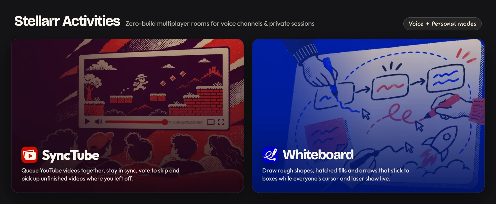
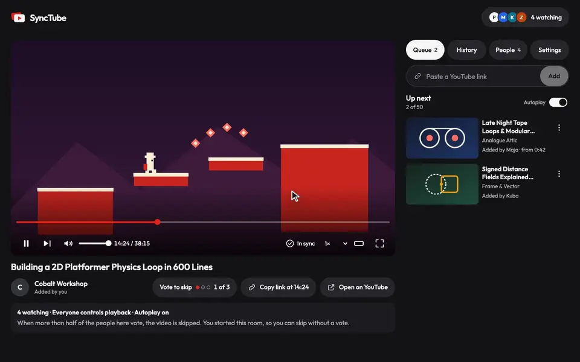
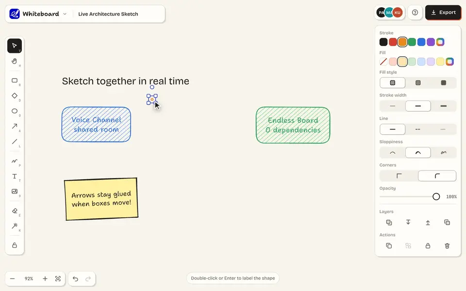

# Stellarr Activities

Activities run inside Stellarr voice channels. Some also work solo, such as Whiteboard for private sketches. Paste this repository URL into Cockpit once, pick an activity, and everyone in the channel can jump in with zero setup.

---

## [SyncTube](synctube/): Watch YouTube together in sync

Drop any YouTube link into the side panel to start a watch party. The first video opens the room, and every link pasted after it lines up in the shared queue.

- **Accepts every YouTube link format:** standard watch URLs, `youtu.be`, Shorts, Music, mobile and live links, plus start timestamps (`?t=1m15s`).
- **Frame-tight room playback:** play, pause, scrub and change speed (`0.5×` to `2×`) for everyone at once. Late joiners land on the current timestamp automatically.
- **Democratic skip votes:** anyone can vote to skip, and the room moves on as soon as more than half of the viewers agree. The host, room founder and instance owner can skip right away.
- **Saved spots per account:** SyncTube remembers where you stopped in unfinished videos. Open an empty room later to resume from that exact second.
- **Personal device controls:** set your own volume on top of Stellarr's Game audio slider and press `T` for cinema mode.

**[See the full SyncTube tour and screenshots →](synctube/)**

---

## [Whiteboard](whiteboard/): Sketch together on an endless board

Everyone in the voice channel draws on the same infinite canvas at the same time. The rough-ink renderer, hatching fills, arrow routing and interface are built from scratch with zero dependencies.

<picture>
  <source media="(prefers-color-scheme: dark)" srcset="docs/whiteboard/board-dark.webp">
  <source media="(prefers-color-scheme: light)" srcset="docs/whiteboard/board-light.webp">
  
</picture>

- **Hand-drawn shapes that match on every screen:** rectangles, diamonds, ellipses, polygons, lines, arrows and pressure-sensitive ink with hachure, cross-hatch or solid fills.
- **Arrows stick to boxes:** drop an arrow onto a shape and it stays attached when someone moves, resizes or rotates that shape. Double-click any shape to type a centered label inside it.
- **Live cursors, selections and laser pointer:** watch teammates drag and sketch in real time. Hold `K` to circle parts of a diagram with a glowing laser trail.
- **Undo that respects teammates:** `Ctrl+Z` / `Cmd+Z` only reverts your own strokes and never overwrites something another person edited since.
- **Light and dark paper, PNG and SVG export:** matches Stellarr's theme and English or Polish locale. Exports `1×`/`2×`/`3×` PNGs or SVGs and backs up your last board to your account.

**[See the full Whiteboard tour and screenshots →](whiteboard/)**

---

## Games

| Activity | Where to play | What to do |
| --- | --- | --- |
| [Arcade Chess](arcade-chess/) | Voice or solo | Play a timed match, challenge a bot, solve puzzles or export your game as PGN. |
| [Doodle Drift](doodle-drift/) | Voice or solo | Pass drawings and captions around the room or make a solo flipbook. |
| [Gif Me a Break](gif-me-a-break/) | Voice | Answer a prompt with a GIF and vote on the submissions. The instance must have GIPHY configured. |

## Add an activity to Stellarr

1. Open **Cockpit → Activities** on your Stellarr instance and paste `https://github.com/Arkazzae/StellarrActivities`.
2. Pick one of the five activities, check its version, download size and permissions, and select **Install and enable**.
3. Start a shared activity from a voice channel. For a solo session, open **Add a server and more → Solo activities** at the bottom of the left rail and choose Whiteboard, Arcade Chess or Doodle Drift.

Each activity updates and uninstalls independently in your library.

[Published releases](https://github.com/Arkazzae/StellarrActivities/releases) · [Contribution guide](CONTRIBUTING.md) · [MIT License](LICENSE)
