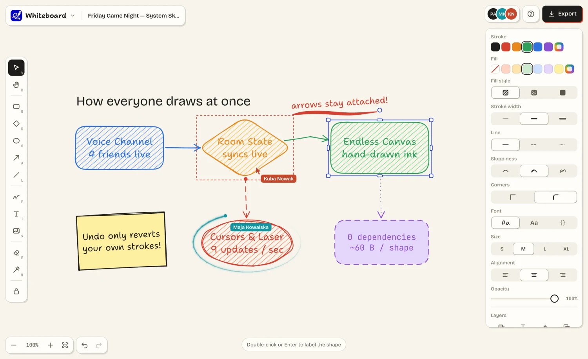
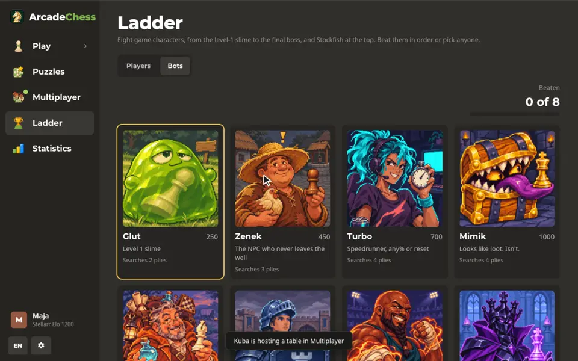
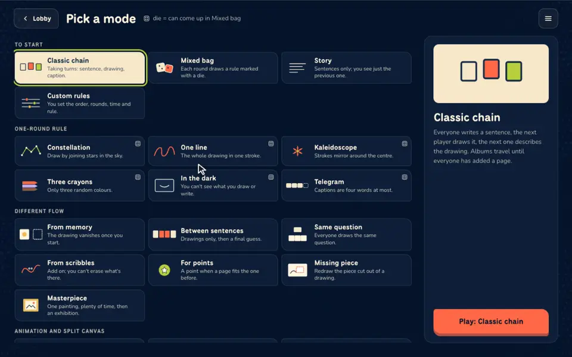

# Stellarr Activities

Multiplayer apps and party games that run directly inside a Stellarr voice channel, with solo modes for private boards, chess training and flipbooks. Paste this repository URL into Cockpit once, install the activities you want, and jump in with zero setup.

---

## [SyncTube](synctube/): Watch YouTube together in sync

Drop any YouTube link into the side panel to start a watch party. The first video opens the room, and every link pasted after it lines up in the shared queue.

- **Accepts every YouTube link format:** standard watch URLs, `youtu.be`, Shorts, Music, mobile and live links, plus start timestamps (`?t=1m15s`).
- **Frame-tight room playback:** play, pause, scrub and change speed (`0.5×` to `2×`) for everyone at once. Late joiners land on the current timestamp automatically.
- **Democratic skip votes:** anyone can vote to skip, and the room moves on as soon as more than half of the viewers agree. The host, room founder and instance owner can skip right away.
- **Saved spots per account:** SyncTube remembers where you stopped in unfinished videos. Open an empty room later to resume from that exact second.
- **Personal device controls:** set your own volume on top of Stellarr's Game audio slider and press `T` for cinema mode.

**[See the full SyncTube tour and screenshots →](synctube/)**

---

## [Whiteboard](whiteboard/): Sketch together on an endless board

Everyone in the voice channel draws on the same infinite canvas at the same time. The rough-ink renderer, hatching fills, arrow routing and interface are built from scratch with zero dependencies.

<picture>
  <source media="(prefers-color-scheme: dark)" srcset="docs/whiteboard/board-dark.webp">
  <source media="(prefers-color-scheme: light)" srcset="docs/whiteboard/board-light.webp">
  
</picture>

- **Hand-drawn shapes that match on every screen:** rectangles, diamonds, ellipses, polygons, lines, arrows and pressure-sensitive ink with hachure, cross-hatch or solid fills.
- **Arrows stick to boxes:** drop an arrow onto a shape and it stays attached when someone moves, resizes or rotates that shape. Double-click any shape to type a centered label inside it.
- **Live cursors, selections and laser pointer:** watch teammates drag and sketch in real time. Hold `K` to circle parts of a diagram with a glowing laser trail.
- **Undo that respects teammates:** `Ctrl+Z` / `Cmd+Z` only reverts your own strokes and never overwrites something another person edited since.
- **Light and dark paper, PNG and SVG export:** matches Stellarr's theme and English or Polish locale. Exports `1×`/`2×`/`3×` PNGs or SVGs and backs up your last board to your account.

**[See the full Whiteboard tour and screenshots →](whiteboard/)**

---

## [Arcade Chess](arcade-chess/): Pixel-art bots, channel tables and puzzles

Host timed chess tables in your voice channel while friends watch. You can also play solo against eight pixel-art video-game rivals and Stockfish.

- **Eight game-inspired bots:** battle from `Glut` (`250`) and `Turbo` (`700`) up to `Mordax` (`2200`), or set Stockfish between levels `0` and `20`.
- **Multi-table voice room:** run several matches at once in one channel, with live spectating, rematches and **Stellarr Elo** saved to your account.
- **190 puzzles and Puzzle Rush:** solve the daily tactic, race the three-minute Puzzle Rush clock, practice checkmate themes, or drill endgames against Stockfish.
- **Post-game Stockfish review:** step through finished games, track win rates by color and ECO opening, copy PGN, and pick from three piece sets and six board palettes.

**[See the full Arcade Chess tour and screenshots →](arcade-chess/)**

---

## [Doodle Drift](doodle-drift/): Telephone drawing across 22 modes

Everyone starts an album and passes sentences, drawings and captions around the channel (up to 14 players, plus solo modes). At the end, the host walks the room through every page.

- **22 party modes:** play **Classic chain**, roll round twists in **Mixed bag**, connect stars in **Constellation**, mirror strokes in **Kaleidoscope**, or paint one shared **Mosaic**.
- **Animations and patchwork monsters:** draw onion-skin frame animations in **Flipbook** and **Relay animation**. Or split head, body and legs across three players in **Patchwork monster**.
- **Live stamps and GIF export:** react with floating stamps as each album unfolds, then save your favourite chain or animation as a shareable GIF.

**[See the full Doodle Drift tour and screenshots →](doodle-drift/)**

---

## [Gif Me a Break](gif-me-a-break/): Answer prompts with the sharpest GIF

A reaction-GIF party game for 3 to 8 players in a voice channel. English and Polish players read the game in their own language in the same room (requires GIPHY on the Stellarr instance).

- **Four game modes:** **Classic** search, **Banned words** (blocks prompt words), rotating **Director** (`3 pts` judge's pick), and **Captions** (write a line for a shared GIF).
- **Anonymous spotlight show:** submissions play one by one while everyone throws five die-cut reaction stickers (`haha`, `10/10`, `nieee`, `pff`, `brawo`) across the screen.
- **Podium and match awards:** crowns the top three players with awards like **On a roll**, **Full house** and **Fastest finger**, plus a winning-meme reel.

**[See the full Gif Me a Break tour and screenshots →](gif-me-a-break/)**

---

## [Kings Reigns](kings-reigns/)

One of the king’s four advisors is a traitor. Vote on decrees, keep the kingdom standing and decide whom to put on trial. The repository includes the Polish game’s source and instructions for running it locally.

---

## Add an activity to Stellarr

1. Open **Cockpit → Activities** on your Stellarr instance and paste `https://github.com/Arkazzae/StellarrActivities`.
2. Pick a published activity, review its version, download size and permissions, and select **Install and enable**.
3. Start a shared session from a voice channel. For solo play, open **Add a server and more → Solo activities** in the left rail for **Whiteboard**, **Arcade Chess** or **Doodle Drift**.

Each activity updates and uninstalls independently in your library.

[Published releases](https://github.com/Arkazzae/StellarrActivities/releases) · [Contribution guide](CONTRIBUTING.md) · [MIT License](LICENSE)
