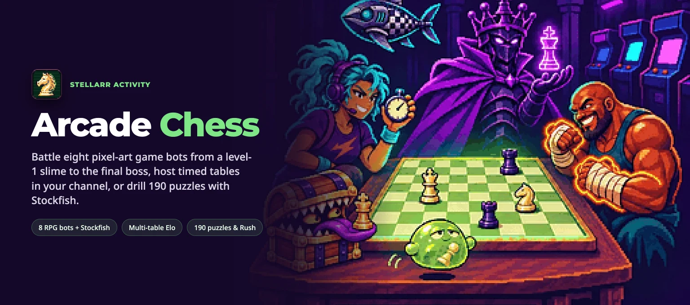
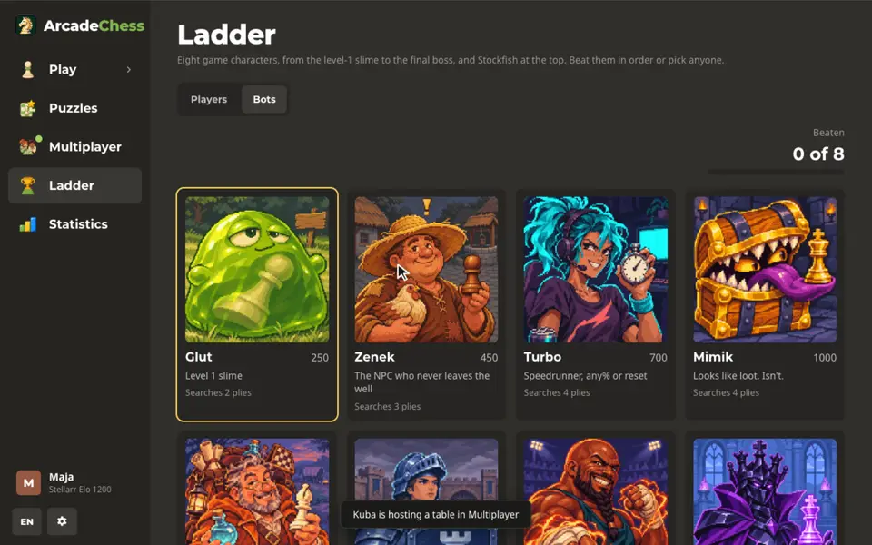
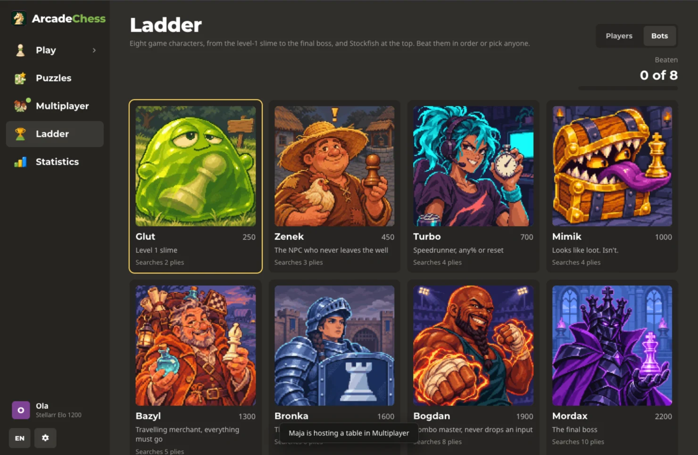
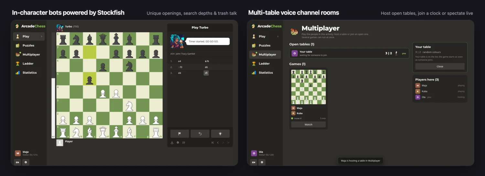
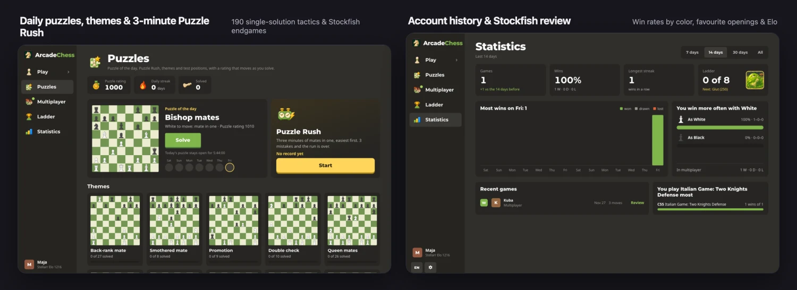

# Arcade Chess

Arcade Chess brings timed multiplayer tables, a pixel-art rival ladder, tactical puzzles and Stockfish analysis into Stellarr. Play head-to-head in a voice channel while friends spectate, or open a solo session to climb the bot ladder and drill tactics.

## Climb an eight-bot video-game ladder

Every opponent parodies a classic video-game archetype with a 32-bit pixel-art portrait, custom search depth and bilingual chat. Configurable **Stockfish** (levels `0` to `20`, depth and move time) waits at the top.

| Rival | Target Elo | Playstyle |
| --- | --- | --- |
| **Glut** | `250` | Level-1 slime. Plays half its moves at random and gobbles up loose pieces. |
| **Zenek** | `450` | Village NPC by the well. Pushes pawns slowly and repeats familiar lines. |
| **Turbo** | `700` | Any% speedrunner. Moves at once, brings the queen out early and hunts quick mates. |
| **Mimik** | `1000` | Dungeon chest trap. Waits quietly, then springs sudden checks. |
| **Bazyl** | `1300` | Travelling merchant. Trades pieces at every opportunity. |
| **Bronka** | `1600` | Shield tank in plate armour. Builds a stubborn wall of pawns. |
| **Bogdan** | `1900` | Arena combo fighter. Chains forcing checks and captures. |
| **Mordax** | `2200` | Final boss. Searches 10 plies deep with a second-phase attitude in chat. |
| **Stockfish** | `0–20` | Full engine strength dialled to the skill level, depth or clock you pick. |

## Host tables in your voice channel

Open **Multiplayer** to run a mini chess club inside your voice channel:

- **Multiple boards at once:** host a table with your clock and color, join an open table, or click **Watch** to spectate any live game.
- **Stellarr Elo ladder:** rated channel games start at `1200` (`K = 32`), rank the session, and save your rating to your Stellarr account.
- **Built for live calls:** offer draws, play rematches with swapped colors, and reload mid-game safely. Referee duties pass automatically if the host leaves.

## 190 puzzles, Puzzle Rush and Stockfish review

- **Daily puzzle and streaks:** solve a fresh single-solution tactic every day. Or race the three-minute **Puzzle Rush** clock, where three mistakes end the run.
- **Themed drills and endgames:** practice back-rank, smothered and piece-specific mates, promotions and double checks, or play endgames against Stockfish's defense.
- **Stats, themes and PGN:** track up to 40 games by color and ECO opening, review moves with Stockfish, copy PGN, or start from **Chess960** and custom FENs. Pick from three piece sets and six board palettes in **Settings**.

## Install in Stellarr

Open **Cockpit → Activities**, paste `https://github.com/Arkazzae/StellarrActivities`, choose **Arcade Chess**, and click **Install and enable**. Launch it in a voice channel for multiplayer tables, or open **Add a server and more → Solo activities → Arcade Chess** for bots and puzzles.

[All activities](../README.md) · [Changelog](CHANGELOG.md) · [Releases](https://github.com/Arkazzae/StellarrActivities/releases) · [Artwork and licences](ARTWORK.md)
