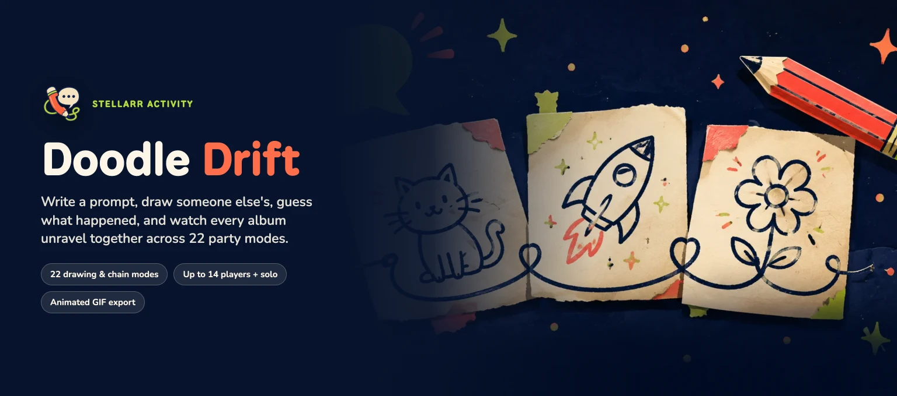
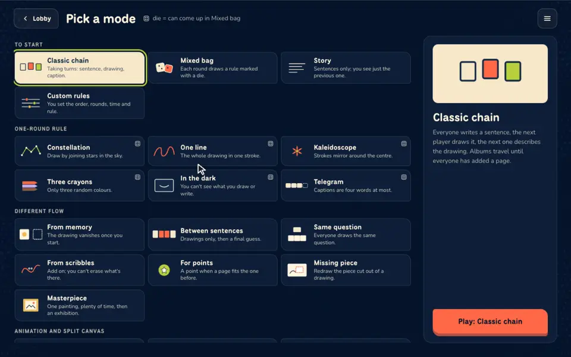
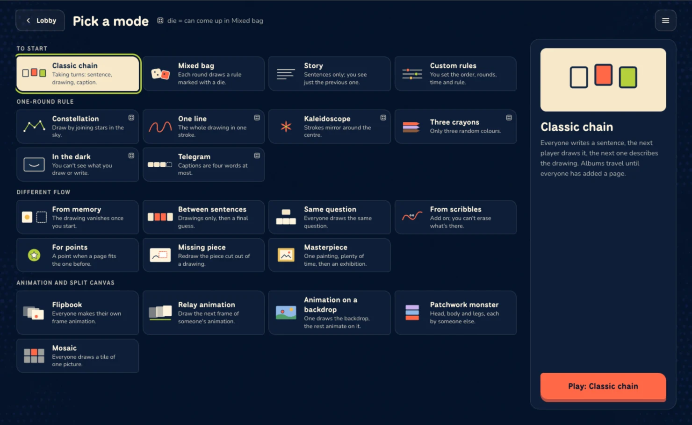
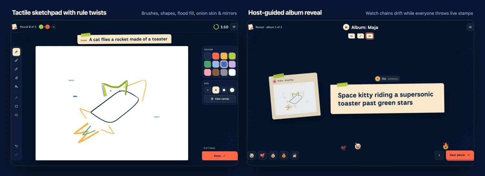

# Doodle Drift

Doodle Drift is a broken-telephone drawing game for up to 14 players in a Stellarr voice channel, plus solo modes. Everyone starts an album, passes prompts, drawings and guesses around the circle, and watches the host walk through every page at the reveal.

## Twenty-two modes, from classic chains to shared mosaics

Pick a familiar sentence-drawing-caption chain, roll a random constraint every round in **Mixed bag**, or switch the structure of the game completely.

- **To start:** play **Classic chain**, roll a die twist per drawing in **Mixed bag**, write **Story** lines, or set **Custom rules**.
- **One-round twists:** connect stars in **Constellation**, draw in **One line**, mirror strokes in **Kaleidoscope**, or use **Three crayons**. You can also sketch blind **In the dark** or cap captions at four words in **Telegram**.
- **Different flows:** redraw vanishing art **From memory**, guess the opening line in **Between sentences**, or answer the **Same question**. Build **From scribbles**, fill a **Missing piece**, score links **For points**, or frame a **Masterpiece**.
- **Animation and split canvas:** draw onion-skin frames in **Flipbook**, **Relay animation** and **Animation on a backdrop**. Or split creatures in **Patchwork monster** and paint live tiles of one **Mosaic**.

## Tactile sketchpad and group reveal

- **Built-in drawing studio:** sketch with pen, brush, marker, flood fill and shapes across 12 colors and four sizes. Includes undo, redo, onion-skin overlays and kaleidoscope mirrors.
- **Step-by-step reveal:** the host flips through each album at the group's pace while everyone throws live floating reaction stamps (`😂`, `❤️`, `😮`, `🔥`, `👏`).
- **Save any chain as a GIF:** export your favourite album or flipbook animation as a shareable GIF at the end screen. Interface copy switches automatically between English and Polish.

## Install in Stellarr

Open **Cockpit → Activities**, paste `https://github.com/Arkazzae/StellarrActivities`, choose **Doodle Drift**, and click **Install and enable**. Start it in a voice channel for group play, or open **Add a server and more → Solo activities → Doodle Drift** for solo modes like **Flipbook**.

[All activities](../README.md) · [Changelog](CHANGELOG.md) · [Releases](https://github.com/Arkazzae/StellarrActivities/releases)
