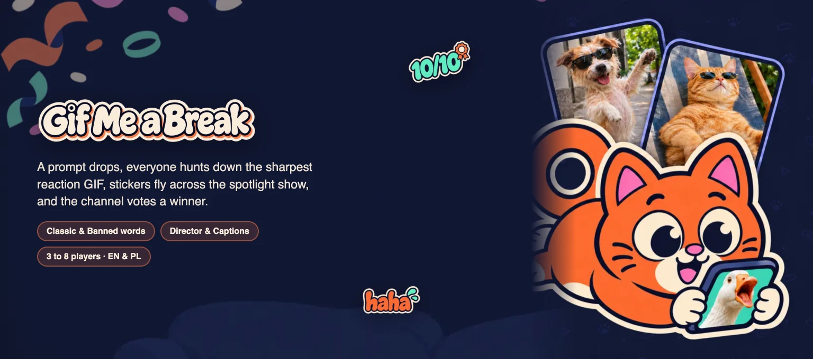
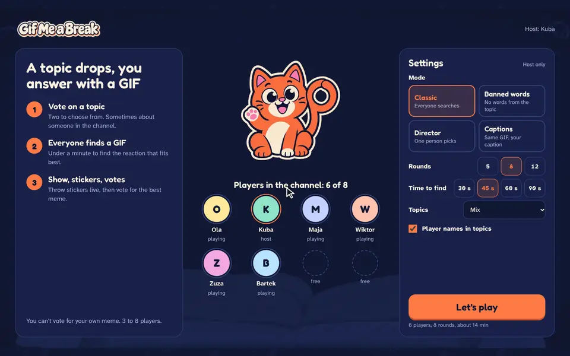
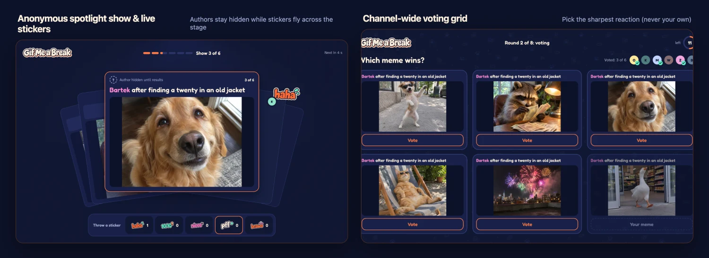
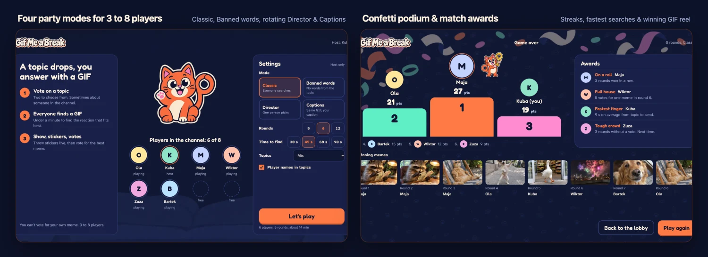

# Gif Me a Break

Gif Me a Break is a reaction-GIF party game for 3 to 8 players in a Stellarr voice channel. A prompt drops, everyone hunts down the sharpest GIF, submissions play under the spotlight while stickers fly, and the room votes a winner.

## Anonymous spotlight show and live stickers

Each player reads prompts, labels and awards in English or Polish from their own Stellarr locale, even in mixed-language channels.

- **Vote on the prompt:** each round offers two situations (with an option to weave channel members' names into the jokes).
- **Privacy-safe GIPHY search:** search runs through Stellarr's `media.gifs` proxy, keeping API keys and player addresses private.
- **Throw stickers mid-show:** authors stay hidden during the reveal while everyone throws five stickers (`haha`, `10/10`, `nieee`, `pff`, `brawo`).
- **Desktop, tablet and phone layouts:** scales cleanly from widescreen desktop stages down to vertical mobile screens.

## Four ways to play, plus end-of-match awards

- **Classic:** everyone searches for a GIF and votes (`1 pt` per vote, never for your own submission).
- **Banned words:** search refuses words from the prompt and their inflected forms, forcing creative workarounds.
- **Director:** one rotating player picks the round's prompt and crowns a single `3 pt` winner.
- **Captions:** two random GIFs appear, everyone writes a caption up to 90 characters, and the room votes on the funniest line.

At the end, Pętlik crowns the top three on the podium and hands out awards (**On a roll**, **Full house**, **Fastest finger**, **Tough crowd**). Every round-winning meme lines up below.

## Install in Stellarr

Your Stellarr instance needs GIPHY enabled in Cockpit so `media.gifs` searches are available. Open **Cockpit → Activities**, paste `https://github.com/Arkazzae/StellarrActivities`, choose **Gif Me a Break**, and click **Install and enable**. Gather 3 to 8 people in a voice channel and launch the activity to play.

[All activities](../README.md) · [Changelog](CHANGELOG.md) · [Releases](https://github.com/Arkazzae/StellarrActivities/releases) · [Artwork notes](ARTWORK.md)
