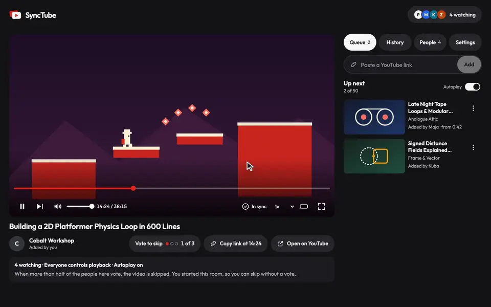
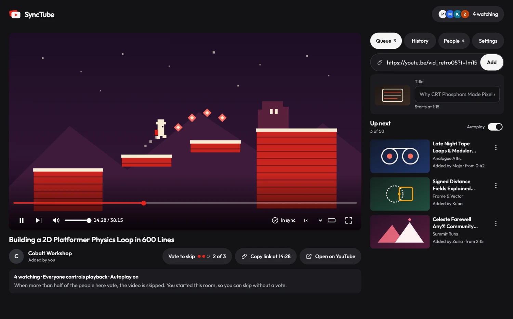
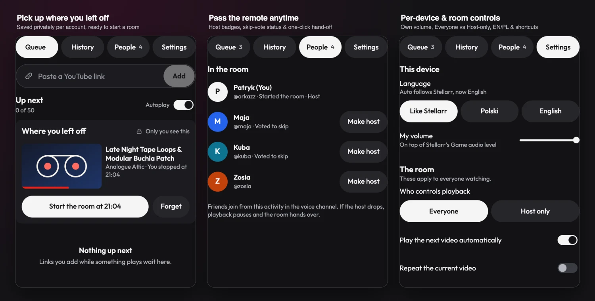

# SyncTube

SyncTube turns a Stellarr voice channel into a shared screening room. Paste a YouTube link in the side panel: the first video starts the room, and later links line up in the queue.

## Queue links from anywhere on YouTube

Paste `youtube.com/watch`, `youtu.be`, Shorts, YouTube Music, mobile, embed or live links, or drop in an 11-character video ID. SyncTube previews the thumbnail, title and start timestamp (`?t=1m15s` or `?start=42`) before you add it. You can also rename the entry on the spot.

A room holds up to 50 upcoming videos. **History** keeps the last 100 played or skipped items so one click queues any of them again.

## Everyone watches the same second

Play, pause, jump five seconds with the arrow keys, or scrub the timeline, and everyone in the room follows. Late joiners start at the current playback position automatically. When watching through YouTube's embedded player or the bundled offline sample clip, the room also shares playback speed from `0.5×` to `2×`.

If the current host disconnects, SyncTube pauses at the last five-second checkpoint so the next host can resume cleanly.

## Skip votes, host hand-off and saved spots

- **Vote to skip:** anyone in a voice room can cast a skip vote. Once more than half of the connected viewers vote, SyncTube advances to the next queued video. The host, the person who started the room and the instance owner can skip immediately without waiting for votes.
- **Pass the remote:** open **People** to see who is watching and who voted, or click **Make host** to hand over playback control.
- **Pick up where you left off:** on Stellarr hosts with account progress enabled, SyncTube privately saves your spot in up to 40 unfinished videos. Open an empty room and a **Where you left off** card offers to start from that exact timestamp.
- **Your device, your volume:** mute locally (`M`) or adjust your own volume on top of Stellarr's Game audio slider. Interface text switches between English and Polish automatically or in **Settings**.

## Keyboard shortcuts

| Key | Action |
| --- | --- |
| `Space` | Play or pause for everyone |
| `←` / `→` | Jump 5 seconds backward or forward |
| `M` | Mute or unmute on this device |
| `T` | Toggle wide cinema mode |
| `Esc` | Leave cinema mode or close an open menu |

## Install in Stellarr

Open **Cockpit → Activities**, paste `https://github.com/Arkazzae/StellarrActivities`, choose **SyncTube**, and click **Install and enable**. Start it from a voice channel for a shared room, or open **Friends → Activities → SyncTube → Launch for myself** for a private queue.

[All activities](../README.md) · [Changelog](CHANGELOG.md) · [Releases](https://github.com/Arkazzae/StellarrActivities/releases) · [Artwork and font credits](ARTWORK.md)
