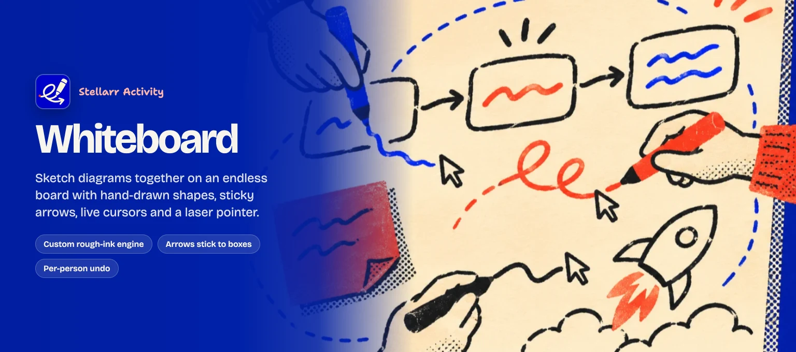
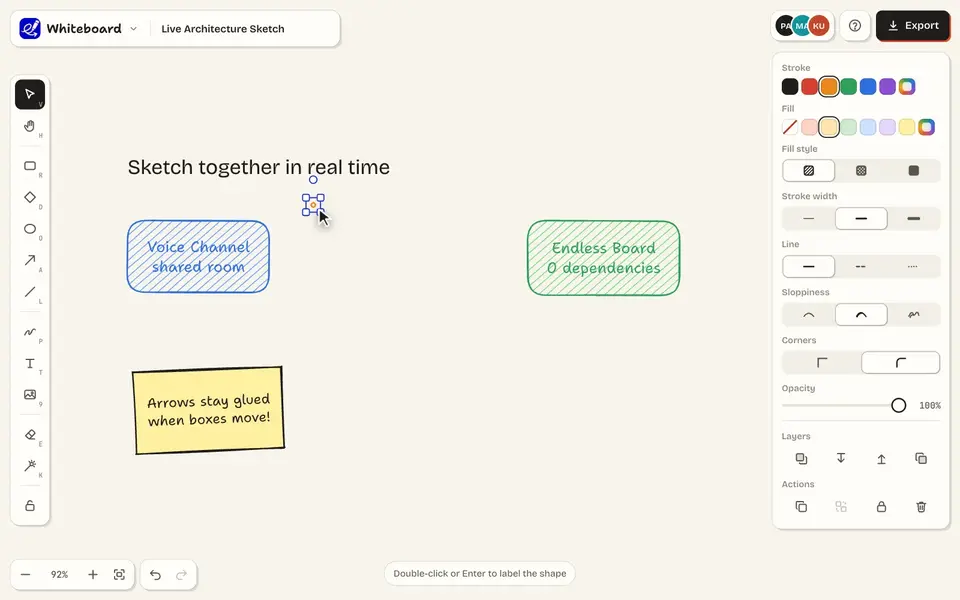
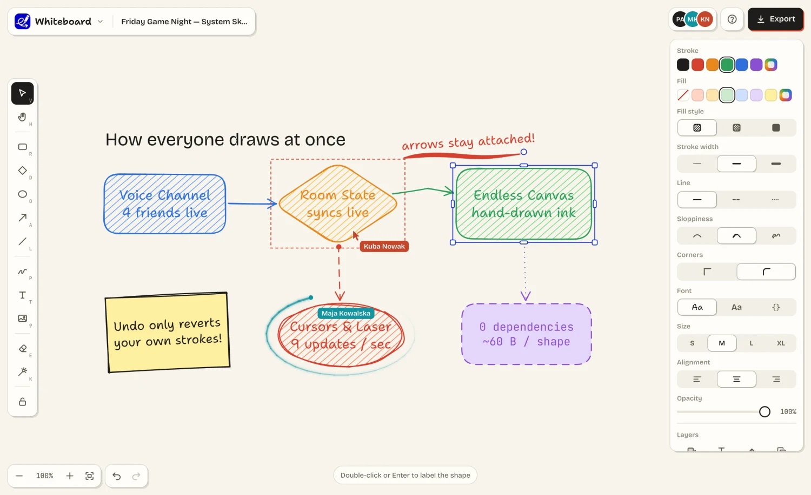
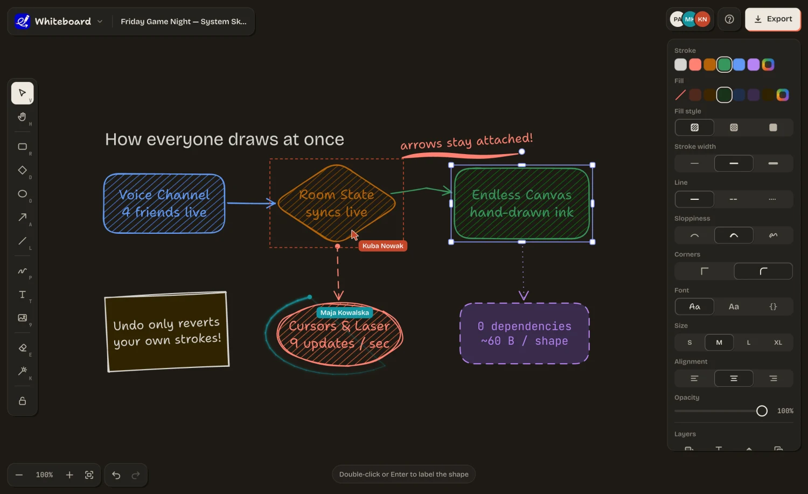
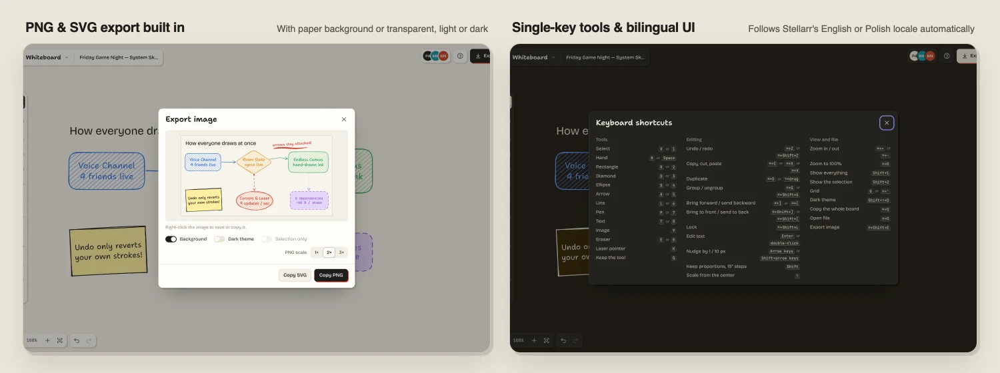

# Whiteboard

Whiteboard gives everyone in a Stellarr voice channel one endless sheet of paper to sketch on together. Every participant can draw at once, and the entire activity runs on its own rough-ink engine written from scratch with zero dependencies.

## Hand-drawn diagrams that stay connected

Draw rectangles (`R`), diamonds (`D`), ellipses (`O`), polygons and lines (`L`), arrows (`A`), pressure-sensitive ink (`P`), text (`T`) and images (`9`). Each shape carries its own random seed, so wobbly strokes and hatched fills look identical for everyone in the room.

<picture>
  <source media="(prefers-color-scheme: dark)" srcset="../docs/whiteboard/board-dark.webp">
  <source media="(prefers-color-scheme: light)" srcset="../docs/whiteboard/board-light.webp">
  
</picture>

- **Sticky arrows:** end an arrow on any shape, text block or image and it attaches to the outline. Move, resize or rotate the box and every connected arrow re-routes on the fly.
- **Auto-growing shape labels:** double-click a rectangle, diamond or ellipse to type inside it, and the shape expands to fit your lines.
- **Print-inspired styling:** choose stroke and pastel fill colors, hachure, cross-hatch or solid fills, dashed or dotted lines, and three sloppiness levels. Three bundled fonts (`Shantell Sans`, `Bricolage Grotesque` and `JetBrains Mono`) include full Polish characters.
- **Full layout controls:** group (`Ctrl+G` / `Cmd+G`), lock, align, distribute, reorder layers, and snap to a 20 px grid (`G`). Hold `Shift` while resizing or rotating for locked proportions and 15° angle steps.

## Built for five cursors moving at once

Other people's named cursors, selections and drags update live (~9 times per second) before they let go of the pointer. Hold `K` (or pick the **Laser pointer** tool) to draw a bright temporary trail when pointing something out during a call.

When two people edit the same board, `Ctrl+Z` / `Cmd+Z` only reverts your own changes and leaves anything a teammate touched afterward intact. Dropped images stream directly from participant to participant, including to late joiners.

## Light paper, dark charcoal, and instant export

| Warm paper (Light mode) | Charcoal ink (Dark mode) |
| --- | --- |
|  |  |

Whiteboard follows Stellarr's light or dark theme (or your manual pick). It remaps strokes and pastel hatches for dark paper without altering imported photos.

Export any board or selection to a `1×`, `2×` or `3×` PNG (on paper or transparent) or copy SVG vectors. Your preferences and a compressed copy of your last board save to your Stellarr account automatically. Use **Copy the whole board** to paste or save `.whiteboard` files with images, and press `?` for all shortcuts.

## Install in Stellarr

Open **Cockpit → Activities**, paste `https://github.com/Arkazzae/StellarrActivities`, choose **Whiteboard**, and click **Install and enable**. Launch it in a voice channel so everyone shares the board, or open **Friends → Activities → Whiteboard → Launch for myself** for a private scratchpad.

[All activities](../README.md) · [Changelog](CHANGELOG.md) · [Releases](https://github.com/Arkazzae/StellarrActivities/releases) · [Artwork and font credits](ARTWORK.md)
